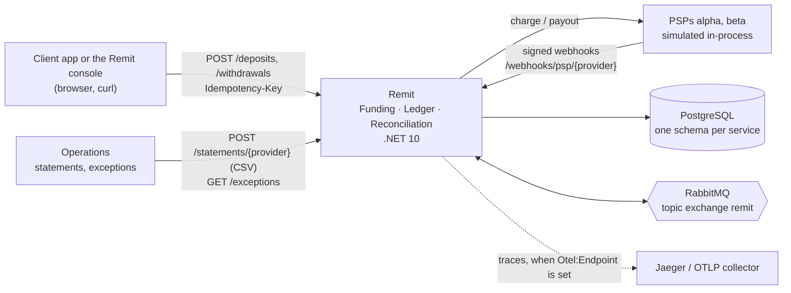
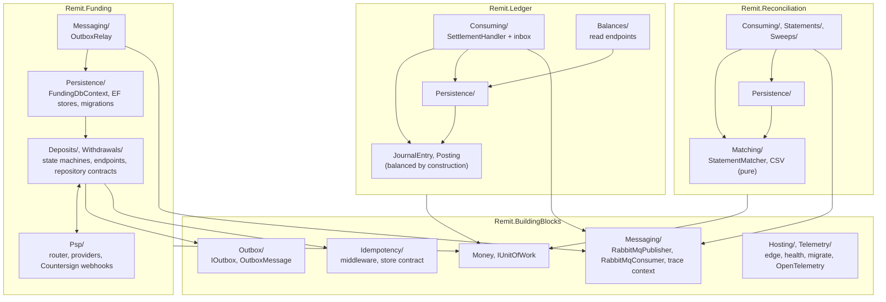
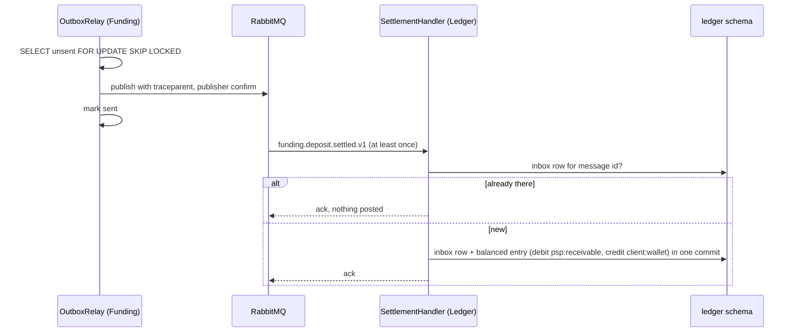
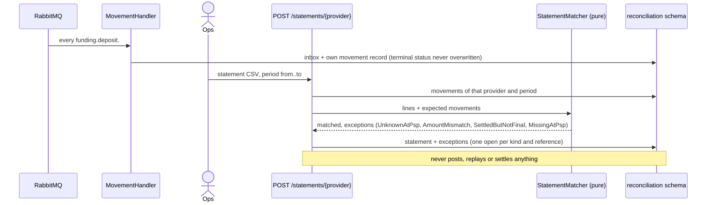
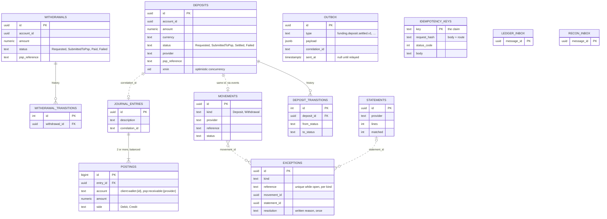

# Architecture — Remit

Five parts, as the value-al Architecture standard asks. Kept true by the architecture tests
in `tests/Remit.Architecture.Tests` (NetArchTest) and by the reviewer, who fails a PR that
changes structure without updating this file. The C4 diagrams and the overview picture in
`docs/architecture/` show the intended production shape (gateway, Redis); this file shows
what the code does today.

## 1. System context



No authentication inside Remit: in production a gateway in front does that (ADR-0001, C4).
No card data ever enters; PSPs exchange references only. Runs locally with
`docker-compose.yml`, as a public sandbox at `remit-sandbox.value.al` (`deploy/sandbox`), and
has an AKS path (`infra/bicep`, `deploy/helm`, ADR-0008) that is deployed by hand.

## 2. Components and allowed dependencies



Rules enforced by `tests/Remit.Architecture.Tests` (each failure says how to fix it):

- `Remit.BuildingBlocks` depends on no service. Services never depend on each other: they
  talk through RabbitMQ events or HTTP (Funding asks the Ledger for balances over HTTP).
- `Deposit`, `Withdrawal`, `JournalEntry`/`Posting`, `Money` and everything in
  `Reconciliation/Matching` are plain C#: no EF Core, Npgsql, RabbitMQ, ASP.NET Core,
  HttpClient, Countersign or OpenTelemetry, and no other folders of their service.
- `Deposits/`, `Withdrawals/` and `Psp/` reach the database only through repository, outbox
  and unit-of-work contracts (one known exception, `EfWithdrawalRepository`; see
  `docs/tech-debt.md`). `Persistence/` never depends on `Psp/` or `Messaging/`.
- Only `Remit.BuildingBlocks.Messaging` uses RabbitMQ.Client; only `Funding/Psp` uses Countersign.

## 3. Key flows

**Deposit: request, provider, signed webhook**

```mermaid
sequenceDiagram
    actor Client
    participant MW as Idempotency middleware
    participant EP as POST /deposits
    participant DB as funding schema
    participant PSP as PspRouter → provider
    participant WH as /webhooks/psp/{provider}
    Client->>MW: POST /deposits + Idempotency-Key
    MW->>DB: claim key (primary key), else replay / 409 / 422
    MW->>EP: first time only
    EP->>DB: deposit Requested + outbox row (one commit)
    EP->>PSP: charge (currency, then health rank; our key passed on)
    PSP-->>EP: accepted / rejected / unavailable
    EP->>DB: SubmittedToPsp or Failed + outbox row (one commit)
    EP-->>Client: 202 with provider and reference
    PSP->>WH: settled, signed {timestamp}.{body}
    WH->>WH: verify signature over raw bytes, 5 min window
    WH->>DB: Settled + funding.deposit.settled.v1 in outbox
```

**Settlement to the ledger, exactly once**



**Reconciliation against a provider statement**



## 4. Data model

One schema per service; no foreign keys across schemas. Dotted lines are references by id only.



## 5. Decision log

| Date | Decision | ADR |
|---|---|---|
| 2026-08-27 | Scope and non-goals: no card data, no FX, one region | [ADR-0001](docs/adr/0001-scope-and-non-goals.md) |
| 2026-08-27 | `Idempotency-Key` at the edge, explicit state machines at the core | [ADR-0002](docs/adr/0002-idempotency-keys-and-state-machines.md) |
| 2026-08-27 | Outbox in every publishing service, never a dual write | [ADR-0003](docs/adr/0003-outbox-over-dual-write.md) |
| 2026-08-27 | Double-entry ledger, balanced by construction; balances derived | [ADR-0004](docs/adr/0004-double-entry-ledger.md) |
| 2026-08-28 | PostgreSQL schema per service, EF Core migrations, polling relay with SKIP LOCKED, xmin concurrency | [ADR-0005](docs/adr/0005-persistence-and-relay.md) |
| 2026-08-28 | One PSP boundary, three outcomes; route by currency then health; settle by signed webhook | [ADR-0006](docs/adr/0006-psp-boundary-and-webhooks.md) |
| 2026-08-28 | Ledger consumes with an inbox; withdrawals mirror deposits; one trace per movement | [ADR-0007](docs/adr/0007-ledger-consumer-withdrawals-telemetry.md) |
| 2026-08-28 | AKS by Bicep, workload identity and Key Vault CSI, migrations as pre-upgrade Jobs | [ADR-0008](docs/adr/0008-aks-workload-identity-key-vault.md) |
| 2026-08-28 | Reconciliation keeps its own record, matches on reference only, never fixes anything | [ADR-0009](docs/adr/0009-reconciliation.md) |
